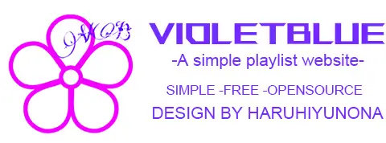

# VioletBlue 1.5




**♡ ReadMe Language ♡**

[](./README.MD) [](./README_Zh.MD) [](./README_En.MD) [](./README_Ja.MD)

# 前言

隔了三年，終於願意更新了。這次要不是 PHP 漏洞這麼嚴重，我大概也不會特別注意這件事。這次把整套技術都升級了，改動有點多，就姑且叫它 1.5.0 吧。

# 環境需求

- PHP 版本：**8.4.1+**（低於 8.4 的版本有高風險漏洞，不再支援）
  - PHP 擴充套件：pdo
  - PHP 擴充套件：pdo_mysql
  - PHP 擴充套件：mbstring
  - PHP 擴充套件：fileinfo
  - PHP 擴充套件：curl
  - PHP 擴充套件：yaml
- MySQL 版本：**8.0.0+**
- Composer 版本：**2.0.0+**
- Node.js 版本：**22.12.0+**
- Yarn 版本：**1.22.0+**

# 安裝

## ♡ 使用 Docker（推薦）♡

這個似乎沒什麼好講的。在 [Releases](https://github.com/HaruhiYunona/VioletBlue/releases) 下載並解壓縮 `docker_你要的版本.zip`，編輯解壓縮目錄下的 `config.yaml`，填好資料庫設定，匯入映像檔後直接啟動即可。

映像檔不包含 MySQL，需要自行在主機上安裝，或將 MySQL 加進映像檔。

開啟 `http://伺服器IP:8080`，首次啟動會自動安裝。後台位址為 `/admin`，預設密碼為 `123456`。各類測試腳本也已備妥，可能需要自行微調程式碼。

## ♡ 使用主機面板／安裝包 ♡

1. 從 [Releases](https://github.com/HaruhiYunona/VioletBlue/releases) 將 `install_你要的版本.zip` 下載到伺服器的 `wwwroot`（PHP 網站目錄），或先下載到本機後再上傳。
2. 設定好網站後，在網站根目錄解壓縮安裝包。這個版本已不需要手動設定網址重寫規則或執行 Composer。
3. 直接開啟網站就會看到安裝頁面，依照提示填寫資料庫資訊即可。

## ♡ 使用原始碼 ♡

### 1. 自訂前端（非必要）

如果想調整介面或新增功能，可以自行修改 `./frontend` 裡的 Vue 專案。

### 2. 執行 Shell 指令建置

指令如下：

```shell
composer install --no-dev --prefer-dist
# 以下為前端建置 #
yarn --cwd frontend install --frozen-lockfile
yarn --cwd frontend build
```

### 3. 連接資料庫

建立一個空資料庫，將 Web 伺服器的網站根目錄指向 `public`，開啟網站，填寫資料庫連線資訊、資料表前綴及管理員密碼。

# 更新

專案已內建線上更新功能，特殊情況下也會發布補丁包。補丁包通常命名為 `patch_對應版本.zip`，不包含全新安裝所需的全部檔案，因此一般不需要另外下載。若線上更新遇到問題，需要手動覆蓋檔案，再將補丁包上傳到網站根目錄並解壓縮即可。任何更新前都請先備份網站與資料。

# 舊版程式遷移

如果是從 1.1 或更早的版本升級，可以依照以下步驟操作：

1. 建立新的資料庫，或在安裝時使用不同的資料表前綴。
2. 安裝完成後，手動刪除資料庫中剛產生的資料表。
3. 將舊資料表改成與新資料表相同的名稱，移到原本新資料表所在的資料庫。如果使用同一個資料庫，就不必移動。
4. 從 [Releases](https://github.com/HaruhiYunona/VioletBlue/releases) 下載 `script_migrate.php`，上傳到網站根目錄。
5. 執行以下指令：

   ```shell
   php migrate.php
   ```

   如果出現錯誤，請修改第 3 行的路徑。要怎麼改，請依實際環境判斷，也可以問 AI。

6. 如果沒有錯誤，而是提示偵測到舊資料庫資訊，恭喜，再執行以下指令就能完成遷移：

   ```shell
   php migrate.php --apply
   ```

   到這裡，資料遷移就完成了。

# 新版功能

1. 修復了許多 Bug，舊介面的問題幾乎都解決了。
2. 批次匯入可以直接上傳檔案。
3. 批次匯入新增錯誤檢查。
4. 手機與電腦可分別自訂主題。
5. 新增線上檢查更新。
6. 新增清空歌單按鈕。
7. 換用了更新的技術。

# 聯絡方式

本專案討論群（QQ）：606917884

作者的 GitHub：[HaruhiYunona](https://github.com/HaruhiYunona)

作者的 X：[@Neko_Kuyo](https://x.com/Neko_Kuyo)
